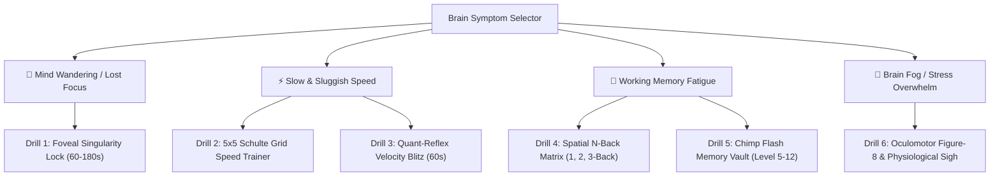

<div align="center">

# ⏳ Chronos HSC: Smart Study Engine
### *The High-Craft Relational Study Engine & Cognitive Focus Lab for HSC Students*

[](https://android.com)
[](https://kotlinlang.org)
[](https://developer.android.com/jetpack/compose)
[](https://developer.android.com/training/data-storage/room)
[](LICENSE)

<br/>

**Chronos HSC** turns chaotic multi-day chapter planning into an automated, zero-friction experience. Unlike standard flat to-do apps, Chronos automatically slices syllabus chapters across 1–15 days, cleans up future tasks with cascade relational integrity, eliminates overdue task paralysis via a 1-tap Domino Shift, tracks exam deadlines with a live glowing countdown FAB, and restores focus on demand with a built-in 6-drill **Neuro-Gym Cognitive Engine**.

---

### 📦 [Direct Download APK (Latest Build)](https://github.com/Shajidur-Rahman/To_Do_Task_STUDY/raw/main/Chronos_HSC_Smart_Study_Engine.apk)
*Ready-to-install Android package (`.apk` • ~18 MB • Offline-First)*

</div>

---

## ⚡ Why Chronos HSC?

| Standard To-Do Apps | The Chronos HSC Study Engine |
| :--- | :--- |
| ❌ Treat multi-day syllabus chapters like flat grocery items | ✅ **Parent-Child Chapter Slicing:** Automatically slices chapters into daily structured phases (`Theory`, `Examples`, `Question Bank`) |
| ❌ Deleting a topic leaves orphaned future tasks behind | ✅ **Cascade Foreign Keys (`CASCADE`):** 1-tap deletes an entire chapter across all past, present, and future dates with full **Undo** |
| ❌ Overdue tasks pile up endlessly, causing guilt & paralysis | ✅ **1-Tap Domino Shift:** Seamlessly cascades unfinished slices forward without stacking them on top of today's work |
| ❌ Forget when critical board exams are taking place | ✅ **Urgent Exam Countdown FAB:** Stacked floating badge featuring live Days-Left calculation, color-coded urgency glow, and prep tracker |
| ❌ No tools to regain focus when your mind wanders | ✅ **Symptom-Driven Neuro-Gym:** 6 interactive cognitive drills (Foveal Singularity Lock, Schulte Grid, N-Back, Chimp Memory, etc.) |

---

## 🚀 Key Feature Arsenal

### 1. ⚔️ The Battleground & Parent-Child Relational Slicing
- **Full HSC Syllabus Coverage:** Native support for **Bangla** (1st & 2nd), **English** (1st & 2nd), **Physics** (1st & 2nd), **Chemistry** (1st & 2nd), **Higher Math** (1st & 2nd), **Biology** (1st & 2nd), and **ICT**.
- **Distribution Curves:** Choose between **Flat Workload** or **Concept-to-Problem Curve** (Day 1: Theory $\rightarrow$ Middle: Textbook Examples $\rightarrow$ Final Day: Question Bank & Timed Test).
- **Sub-Counter Problem Tracking:** Track individual problems solved (`[ 2 / 5 Problems + ]`) directly on the card with animated background fill and instant XP feedback.
- **Katana Swipe-to-Slash:** Satisfying swipe gesture with custom `Canvas` particle slashes to mark tasks completed.

### 2. ⏳ Stacked Exam Countdown Command Center
- **Always-Visible Live Urgency Badge:** Positioned right above the `+ Add Study Topic` FAB.
  - `> 60 days`: **Neon Cyan** (`#00E5FF`)
  - `15 to 60 days`: **Electric Amber** (`#FFAB00`)
  - `< 15 days`: **Pulsing Crimson Neon** (`#FF1744`)
- **Countdown Command Center Modal:**
  - Live Days, Hours, and Minutes countdown hero card.
  - Preparation timeline elapsed progress gauge.
  - Fast presets: `HSC Final`, `Test Exam`, `Semester Final`, `Admission` + quick offset chips (`+10d`, `+30d`, `+90d`, `+180d`).
  - Saved timers switcher to pin or delete multiple target exams.

### 3. 🧠 Symptom-Driven Neuro-Gym & Focus Lab
When study fatigue or brain fog hits, access the 4-state **Cognitive Diagnostic Selector** to run targeted 60-second neuroscience resets (`+25 XP` per completed session):



* **Drill 1: Foveal Singularity Lock:** Central cyan dot with contracting harmonic rings, biometric thumb-hold anchor that pauses on gaze release, and peripheral distraction spark suppression.
* **Drill 2: 5x5 Schulte Grid:** Ascending 1–25 speed grid with center fixation dot, anti-cheat visibility, live stopwatch, and optional *Shuffle-on-Tap Hard Mode*.
* **Drill 3: Quant-Reflex Velocity Blitz:** 60-second mental math blitz across 3 auto-scaling tiers with Combo Multipliers ($x1, x2, x4, x8$) and QPM speedometer.
* **Drill 4: Spatial N-Back Matrix:** Prefrontal working memory training with a 3x3 neon grid at 2,200ms intervals, testing 1-Back, 2-Back, or 3-Back spatial recall.
* **Drill 5: Chimp Flash Memory Vault:** Instantaneous spatial encoding test where tiles 2..N mask into solid cyan the exact millisecond tile 1 is tapped.
* **Drill 6: Oculomotor Pursuit & Sigh:** 60fps smooth-pursuit Lemniscate of Bernoulli ($\infty$) orb paired with 6 cycles of the double-inhale *Physiological Sigh*.
* **Telemetry Vault:** Persistent metrics tracking *Focus Stability Score*, *Peak Brain Speed*, and *Working Memory Capacity*.

### 4. 🛡️ RPG Boss Battles & Overdue Shield
- Every chapter is tracked as an **RPG Boss** with segmented HP bars (`totalDays * 100 HP`).
- Missing scheduled days activates an overdue **+10% Purple Boss Shield** that can only be shattered by completing task slices.

### 5. 🧟 Mental Battery Mode Filter
- **⚡ 100% High Focus:** Prioritizes deep derivations and complex mathematical calculations.
- **🔋 50% Medium:** Standard textbook reading and numerical exercises.
- **🧟 15% Zombie Mode:** Automatically collapses heavy tasks into a protected brain footer, offering 1-tap conversion into 15-minute low-friction reviews (flashcards, videos, notes).

### 6. 🎲 Task Roulette & 25-Minute Micro-Sprint
- Overcome task indecision: spin the physics-decelerated roulette wheel to lock onto a task slice.
- Accept within 60 seconds to lock in a **2x XP Multiplier** for a focused 25-minute Pomodoro micro-sprint.

### 7. 🔁 Ebbinghaus Retention Echoes
- Conquering any chapter gives you the option to auto-spawn Spaced Repetition Echoes at research-backed intervals:
  - **Brutal (Hard):** `+2d`, `+5d`, `+14d`
  - **Medium (Good):** `+3d`, `+7d`, `+21d`
  - **Easy (Mastered):** `+5d`, `+14d`, `+30d`
- All echoes share the parent chapter ID, guaranteeing clean cascade deletion if ever modified.

### 8. 📊 12-Week Weighted Heatmap & Home Screen Widget
- GitHub-style 7x12 effort heatmap calculated using:
  $$\text{Daily Effort Score} = (\text{Completed Slices} \times 25) + (\text{Problems Solved} \times 5)$$
- Interactive **Jetpack Glance Home Screen Widget** for glancing at today's battleground directly from your Android launcher.

---

## 🛠️ Architecture & Tech Stack

```
com.chronos.hsc
├── data
│   ├── local
│   │   ├── Entities.kt            # Room entities (TopicChain, DailySlice, ExamCountdown, NeuroSession)
│   │   ├── Enums.kt               # HscSubject, HscPaper, EnergyLevel, NeuroDrillType, etc.
│   │   ├── RoomTypeConverters.kt  # Enum & Date Room type converters
│   │   ├── StudyDao.kt            # Reactive SQLite queries & @Transaction cascade operations
│   │   └── StudyDatabase.kt       # Room Database v3 with safe MIGRATION_2_3
│   └── repository
│       └── StudyRepository.kt     # Single Source of Truth, XP Engine, Domino Shift, Telemetry
├── domain
│   └── Models.kt                  # Clean Domain Models & Summaries
├── ui
│   ├── components                 # High-craft Material 3 components, Boss Bar, Modals, Heatmap
│   ├── screens                    # MainScreen, NeuroGymScreen, Battleground, Bosses, Analytics
│   ├── theme                      # Obsidian Cyberpunk Dark Theme (CyberCyan, CyberMagenta, etc.)
│   └── viewmodel
│       └── StudyViewModel.kt      # Unidirectional StateFlow, UI State & Event coordination
└── widget
    └── ChronosStudyWidget.kt      # Jetpack Glance Home Screen AppWidget
```

* **UI Framework:** 100% Jetpack Compose (Material 3, Dark Obsidian Cyberpunk theme).
* **Concurrency:** Kotlin Coroutines, `StateFlow`, `SharedFlow`, reactive database observations.
* **Local Persistence:** Room SQLite with strict `ForeignKey.CASCADE` relational constraints.
* **Graphics & Haptics:** Custom Compose `Canvas` 60fps animations, Lemniscate of Bernoulli math curves, and tactile haptic feedback.
* **Home Screen:** Jetpack Glance AppWidget.

---

## 📲 How to Install & Run

### Option 1: Direct APK Download
1. Download [**Chronos_HSC_Smart_Study_Engine.apk**](https://github.com/Shajidur-Rahman/To_Do_Task_STUDY/raw/main/Chronos_HSC_Smart_Study_Engine.apk).
2. Open the `.apk` on your Android device (Android 8.0+ / API 26+).
3. If prompted, enable *"Install from Unknown Sources"*.
4. Open **Chronos HSC** and begin your master study routine!

### Option 2: Install via ADB (Connected USB Device)
```bash
# Clone the repository
git clone https://github.com/Shajidur-Rahman/To_Do_Task_STUDY.git
cd To_Do_Task_STUDY

# Install APK directly to your connected device
adb install -r Chronos_HSC_Smart_Study_Engine.apk
```

### Option 3: Build from Source
```bash
# Build the debug APK with Gradle
./gradlew assembleDebug

# Output location:
# app/build/outputs/apk/debug/app-debug.apk
```

---

## 📝 License

Distributed under the Apache License 2.0. See [`LICENSE`](LICENSE) for more information.

<div align="center">
<b>Built with ❤️ for HSC Science Warriors striving for academic excellence.</b>
</div>
